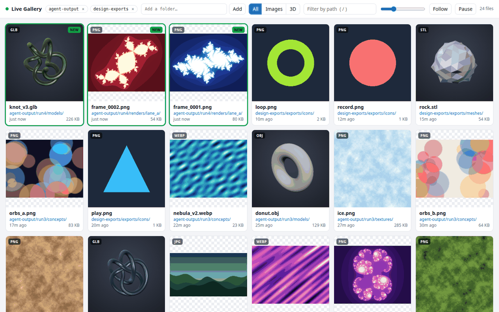
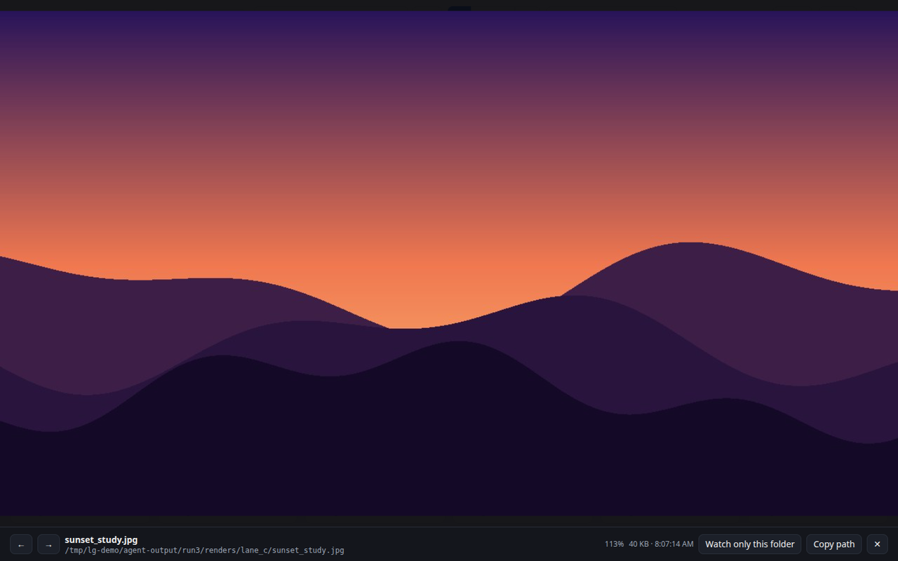
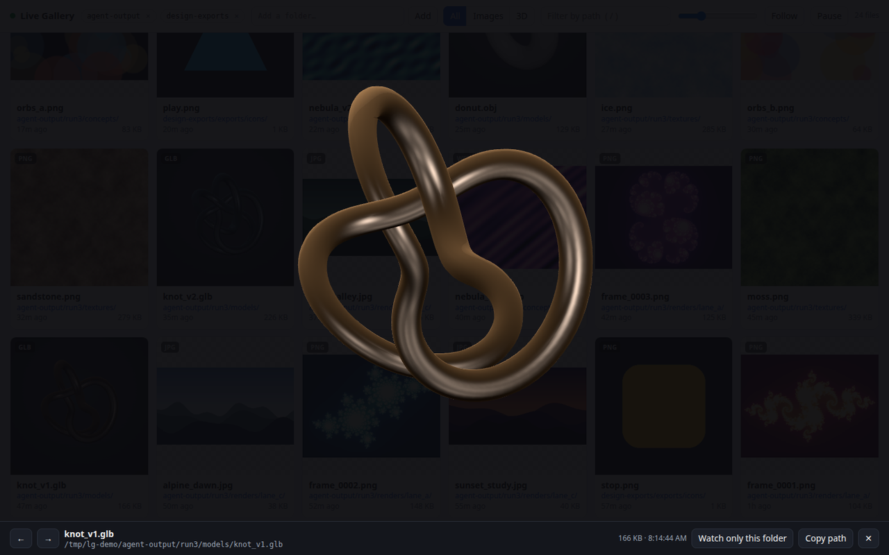
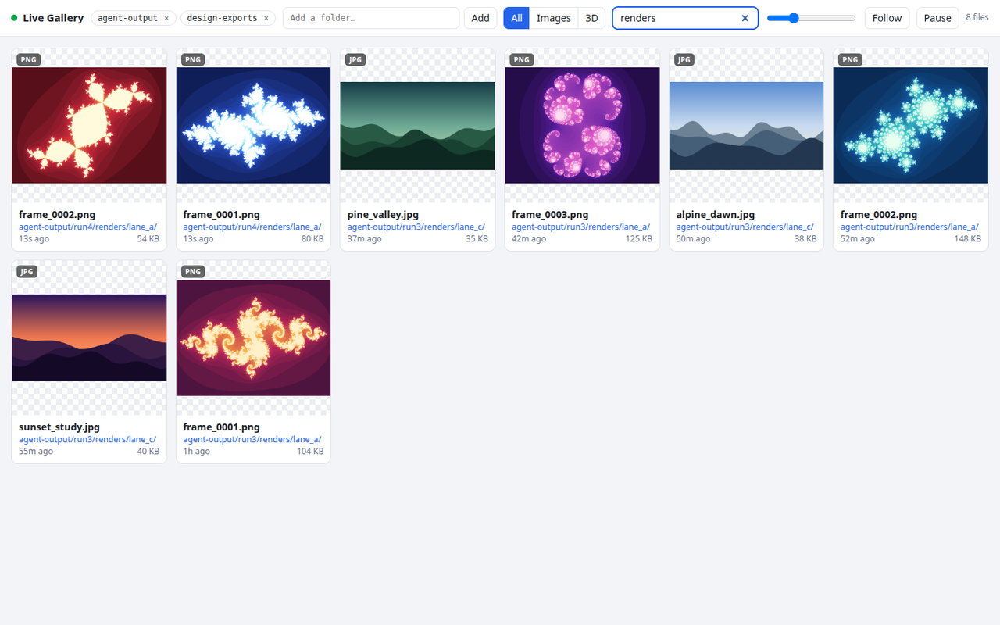
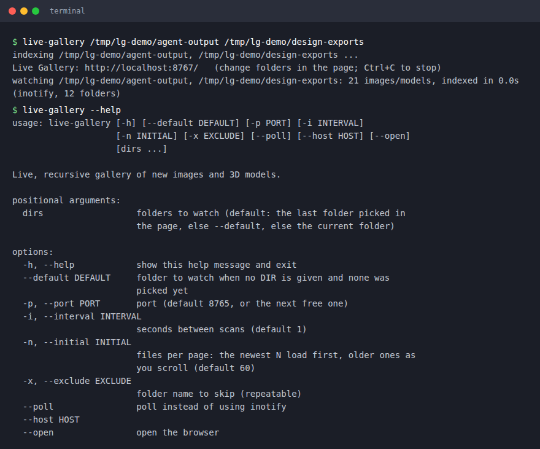
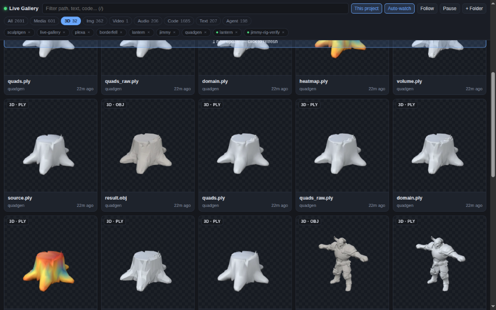
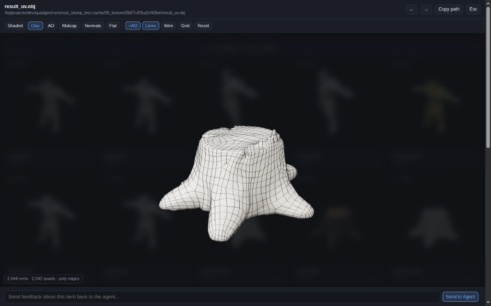

# Live Gallery: a live image and 3D model gallery for any folder

**Live Gallery watches folders and shows every new image or 3D model (glb, gltf, obj, stl, ply, fbx) in your browser the moment it's saved, newest first, however deeply it's nested.** It's a small local server with a browser UI: no account, no upload, nothing to configure.



## Why

AI agents, build scripts, renderers and exporters tend to scatter their output across subfolders:
`run3/renders/lane_c/frame_0042.png`, `exports/meshes/rock.stl`, and so on. Digging through a file
manager, or re-running `ls -t`, to see what just got produced is slow. Keep one browser tab open instead:
new files slide in at the top, as soon as they've finished writing.

Good for watching:

- the output folder of an AI coding agent or image/3D generation pipeline
- Blender, CAD or game-engine exports
- render farms, screenshot tools, test-run artifacts
- any directory tree where images and models keep appearing

## Features

- **Images and 3D in one grid.** Images: png, jpg, gif, webp, svg, avif, bmp, ico. 3D: glb, gltf, obj, stl, ply, fbx, with rendered thumbnails and an orbit viewer (three.js, loaded from a CDN).
- **Recursive and live.** Subfolders are watched automatically. Linux uses inotify (idle until something changes); macOS and Windows poll every second. Files appear once they've finished writing, never half-saved.
- **Newest first, fast.** The page loads the newest 60 files and fetches older ones as you scroll, so a folder with thousands of files opens instantly.
- **Thumbnails made once.** 3D thumbnails render in a background worker (the page never freezes on a big model) and are cached on disk, so the next visit shows them immediately.
- **New / updated / deleted.** New files get a green **NEW** badge. Re-saved files jump back to the top marked **UPDATED**, and deleted files disappear.
- **Handles floods.** When a whole folder is copied or moved in, files appear once they've finished copying and the grid updates in one go. If you're scrolled down looking at older files, it tells you how many arrived instead of moving the page.
- **Several folders at once.** Each watched folder is a chip at the top. Click a chip to show only that folder, or click × to stop watching it. Use the **Add a folder…** box to add more: it autocompletes paths and suggests recent folders. Folders already inside a watched folder are skipped.
- **Filters.** All / Images / 3D. Filter by path (press `/`). Click a card's folder to show only that folder.
- **Follow.** Each new file opens full-size as it arrives, so you can just watch.
- **Pause.** Holds new arrivals so the grid stops moving while you look.
- **Viewer.** See an image at 100%, scroll to zoom up to 16×, drag to pan (`1` = 100%, `0` = fit). 3D models: drag to orbit, scroll to zoom. ←/→ for the next/previous file, Esc or a click on the backdrop to close. "Watch only this folder" and "Copy path" buttons are in the bar.
- **Safe by default.** Serves only image/3D files from inside the folders you're watching, and listens on `127.0.0.1` unless you pass `--host`.

| Image viewer | 3D model viewer |
|---|---|
|  |  |



*Screenshots are real captures of the app running on generated demo files. They are regenerated by `scripts/screenshots.py`.*

## Quick start

Needs Python 3.8+ (standard library only, nothing to `pip install`).

```bash
git clone https://github.com/dashw00d/live-gallery.git
cd live-gallery
python3 live-gallery ~/path/to/folder --open      # macOS / Linux
py live-gallery C:\path\to\folder --open          # Windows
```

Then open http://localhost:8765 (`--open` does it for you). You can change the folder from the page too.

It's a single self-contained file, so you can also just download it:

```bash
curl -O https://raw.githubusercontent.com/dashw00d/live-gallery/main/live-gallery
python3 live-gallery ~/path/to/folder --open
```

### Examples

```bash
# Watch two folders at once
python3 live-gallery ~/projects/renders ~/projects/exports

# Skip extra folder names (common ones like .git and node_modules are already skipped)
python3 live-gallery ~/work -x scratch -x old

# A folder on a network share or /mnt/c under WSL: poll every 3 seconds
python3 live-gallery /mnt/c/Users/me/Pictures --poll -i 3

# Bookmarkable URL that watches specific folders
#   http://localhost:8765/?watch=/path/one,/path/two
```

What it prints on start (real output):



## Options

```
live-gallery [DIR ...] [--port N] [--default DIR] [-x NAME] [--poll] [-i SECS] [-n N] [--host H] [--open]
```

| Flag | Meaning |
|---|---|
| `DIR ...` | Folders to watch. Without it you get the last folder you picked in the page, else `--default`, else the current folder. |
| `-x NAME` | Skip folders with this name (repeatable). `.git`, `node_modules`, venvs, caches, `vendor`, `target`, `.godot`, `.import` and similar are already skipped. |
| `--poll`, `-i SECS` | Check for changes every SECS seconds (default 1) instead of using inotify. |
| `-n N` | Files per page: the newest N load first, older ones as you scroll (default 60). |
| `--port N` | Port (default 8765, or the next free one). |

## How it works

A small HTTP server (Python standard library, or the Rust port) indexes the folders you give it and
serves a single page. The page opens a live event stream, so new, updated and deleted files reach the
browser as they happen. Newest files load first and older ones are fetched on demand. 3D models are
rendered to thumbnails by a web worker in your browser using three.js and cached on disk.

### How it watches

- **Linux.** Uses inotify, so it's idle until something changes and files appear instantly. Each folder takes one
  inotify watch. A tree with ~100k folders is fine under the usual limit; raise `fs.inotify.max_user_watches`
  if you watch something enormous.
- **macOS / Windows.** Checks the folders every second instead. That's great for a project folder. For very
  large trees use `-i 3` or `-x` to skip big folders.
- **WSL.** Run it inside WSL and open `localhost:8765` in your Windows browser. Use `--poll` for folders under
  `/mnt/c`, because changes made from Windows don't trigger inotify there.

## Requirements

- Python 3.8+ for the single-file version, or a Rust toolchain to build the Rust version (below).
- A modern browser. 3D previews need WebGL, and internet the first time, because three.js comes from jsDelivr. Images work offline.

## Notes

- Your chosen folder and recent folders are saved in `~/.config/live-gallery/state.json`.
- 3D thumbnails are cached in `~/.cache/live-gallery/thumbs` (small WebP files; the oldest are pruned
  automatically, and deleting the folder is always safe).

## Rust version

A Rust port with the same flags, page and behavior is in `src/` (one ~3.5 MB binary, no Python needed).
It uses the same `state.json` and thumbnail cache, so you can switch between the two freely. The Python
script remains the reference implementation for now.

```bash
cargo build --release
./target/release/live-gallery ~/path/to/folder --open
```

It builds natively on Linux, macOS and Windows. To make a Windows `.exe` from Linux, install mingw-w64 and run
`rustup target add x86_64-pc-windows-gnu && cargo build --release --target x86_64-pc-windows-gnu`.

## Antigravity 2.0 Plugin (`atg/`)

An embedded Antigravity 2.0 UI Extension lives in [`atg/`](atg/README.md). It mounts directly inside Antigravity's Auxiliary (Side) Pane and expands Live Gallery into a real-time multimodal stream of **3D models, images, videos, audio, code (with live diffs), text, artifacts, and agent outputs**.




Highlights:
- **Per-project auto-filtering** (`Project: <name>` ↔ persistent `All projects` toggle) + **auto-watching** folders that agents write to (via `PostToolUse` hooks, `transcript.jsonl`, and symlinked run directories).
- **Offline 3D inspection:** `Shaded`, `Clay`, `AO` (real-time GTAO), `Matcap`, `Normals`, `Flat`, true quad/polygon `Lines` (no triangle diagonals on `.ply`/`.obj`), `Wire`, `Topo` (non-quads & poles), `Back` (red backfaces), `Lock Cam`, and turntable `Spin`.
- **A/B Compare:** split slider & synced pan/zoom for images; dual synced cameras for 3D models.
- **Annotate → Agent:** draw redlines over any image or 3D viewport snapshot and send straight back into the active chat turn.
- **Revisions, live code diffs, stars (`★`), burst grouping, subfolder mute, and zero-downtime hot reload.**

Install locally:

```bash
agy plugin validate --strict ./atg
agy plugin install ./atg
```

See [`atg/README.md`](atg/README.md) for full details and keyboard shortcuts.

## Regenerating the screenshots

`scripts/screenshots.py` generates procedural demo images and 3D models, runs Live Gallery against them with
a throw-away home directory, and captures the images in `docs/screenshots/` with headless Chromium. It needs
`pip install playwright pillow numpy && playwright install chromium`, and works with either version
(`--rust path/to/binary`).

## License

MIT. See [LICENSE](LICENSE).
