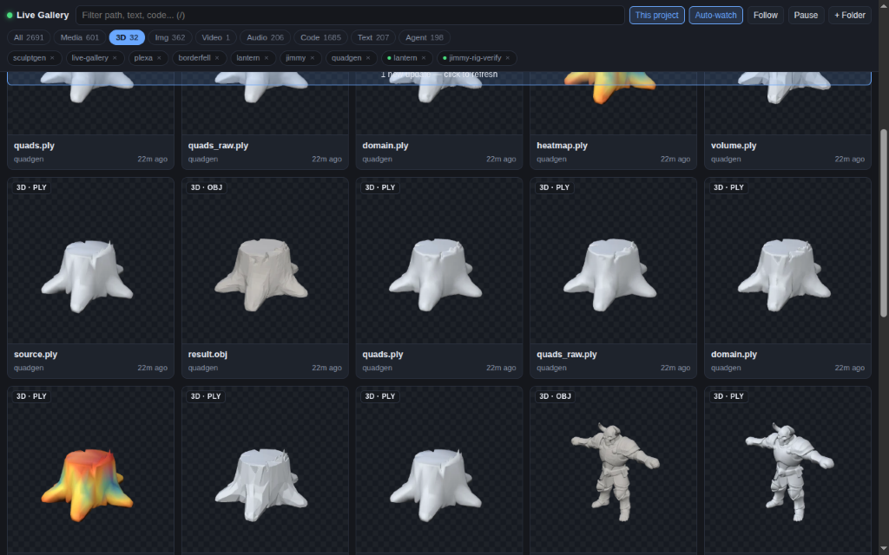
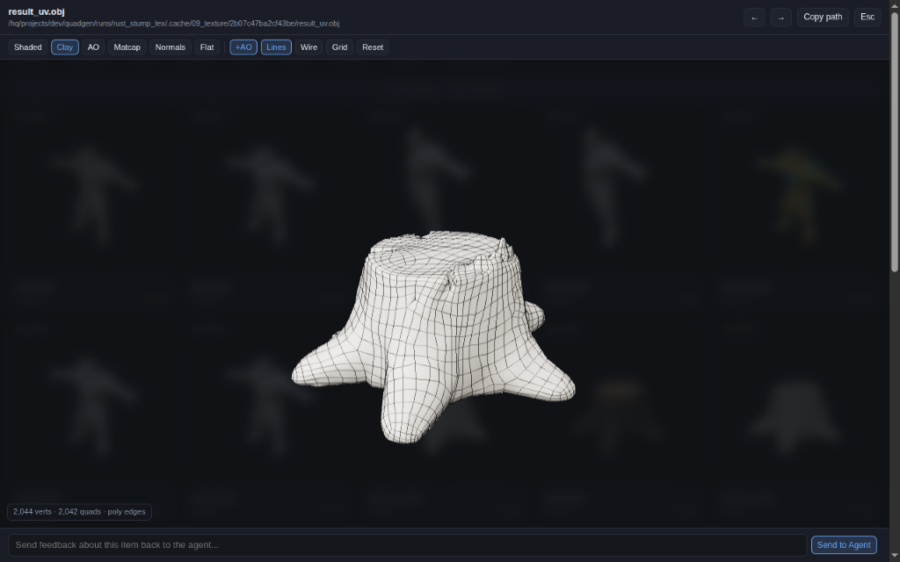

# Live Gallery — Antigravity 2.0 Plugin

A sidecar-backed UI extension that embeds a real-time multimodal output stream directly inside Antigravity 2.0's Auxiliary (Side) Pane.




## Features

- **All agent output types in one stream:**
  - **3D models** (`glb`, `gltf`, `obj`, `stl`, `ply`, `fbx`) — offline-bundled Three.js (`vendor/three-kit.js`), cached WebWorker thumbnails (lazy via `IntersectionObserver`), and a full interactive orbit viewer.
  - **Images** (`png`, `jpg`, `webp`, `gif`, `svg`, `avif`, `bmp`, `ico`) — uncropped `1:1` contain thumbnails with transparency checkerboard + cursor-centered pan/zoom lightbox (`0.25×`–`16×`, `1` = 1:1, `0` = Fit).
  - **Video & Audio** (`mp4`, `webm`, `mov`, `mp3`, `wav`, `ogg`, `flac`, `m4a`) — hover preview, HTTP Range seeking, and pan/zoom on videos.
  - **Code, Text, PDF & Agent outputs** — lazy snippet cards, live **`Diff` / `Source`** toggle (`git diff` or last `edit_file` hunk), PDF preview, and live `transcript.jsonl` + artifact streaming from `~/.gemini/antigravity/brain/`.
- **3D Inspection & Topology QA:**
  - **Shading modes (`1`–`6`):** `Shaded`, `Clay`, `AO` (pure Ground-Truth Ambient Occlusion), `Matcap`, `Normals`, `Flat`.
  - **Overlays:** `+AO` (`A`), true quad/polygon **`Lines`** (`L`, parsed directly from binary/ASCII `.ply` and `.obj` without triangle diagonals), **`Wire`** (`W`), **`Topo`** (`T`, highlights non-quads in red/yellow and extraordinary poles), **`Back`** (`B`, red backfaces), **`Lock Cam`** (`C`, keeps camera angle across `←`/`→`), **`Spin`**, **`Grid`** (`G`), **`Reset`** (`R`), plus live vert/quad/tri/pole counts.
- **Side-by-Side A/B Compare:**
  - Pin any card as **A** (`A/B`) and click **B** to compare:
    - **Images:** draggable split **Slider** or **Side-by-Side**, both with synchronized pan & zoom.
    - **3D models:** dual viewports with **synchronized cameras** and shared shading/AO/Lines/Topo controls.
    - **Code/Text:** side-by-side panes.
- **Visual Feedback & Annotations:**
  - Click **Annotate** (`D`) on any image or 3D model (captures the current 3D angle) to draw redlines (Pen / Arrow / Box in Red / Yellow / Cyan), save to the conversation's artifact directory, and send straight back into chat.
  - Inline reply box at the bottom of the modal routes feedback directly to the conversation via `window.sidecar.agent.sendMessage` / `agentapi`.
- **Auto-Snapshots & Revisions:**
  - Automatically snapshots overwritten files under `~/.cache/live-gallery/revisions/` (LRU capped) with a **`v1 · v2 · Latest`** scrubber and 1-click **Compare v1 vs Latest**.
- **Per-Project Auto-Filtering & Smart Auto-Watch:**
  - Defaults to **`Project: <name>`** (auto-switching as you move between projects/conversations) with a persistent toggle to **`All projects`**.
  - Automatically follows folders agents write to via `SessionStart` / `PostToolUse` hooks and `transcript.jsonl` (including bare relative paths, symlinked `.cache` run stages, and live 30-second mtime detection on `run_command` outputs).
  - Supports **`★` Starred** bookmarks (`S`), **`Group`** burst folding, **Mute dir** for noisy subfolders (e.g. `refs/`), and opening models/media directly from Antigravity's Files tree via `file_extensions`.
- **Zero-Downtime Hot Reload:**
  - `main.mjs` runs Antigravity's `SidecarApp` (`sidecar_sdk`) and automatically hot-swaps the Python backend when `server.py` changes without restarting the Antigravity sidecar.

## Install / Update

```bash
agy plugin validate --strict ./atg
agy plugin install ./atg
```

## Standalone Usage (outside Antigravity)

```bash
python3 ./atg/sidecars/live-gallery/server.py ~/path/to/workspace
```
